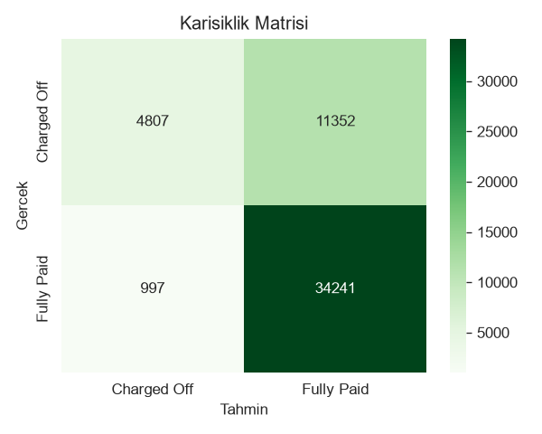
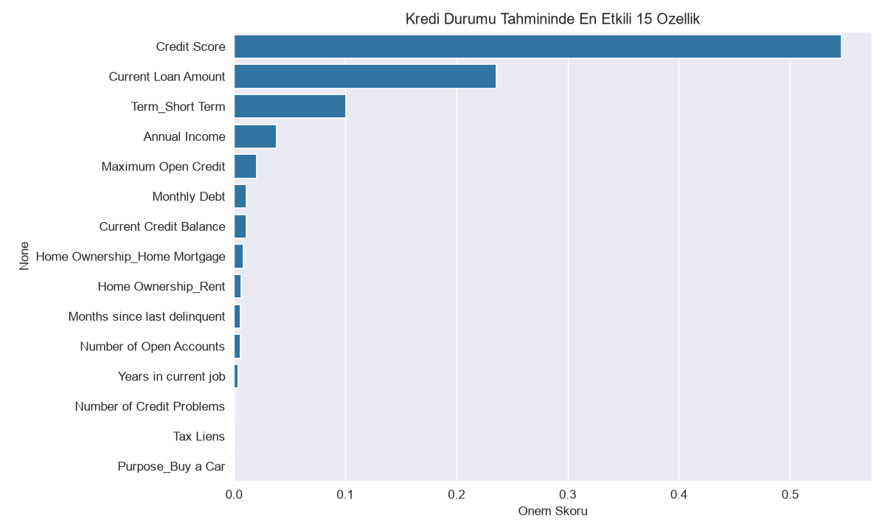

# Kredi Risk Tahmini (Loan Prediction)

Başvuru sahiplerinin finansal geçmişine (kredi skoru, yıllık gelir, mevcut kredi bakiyesi, kredi amacı vb.)
dayanarak bir kredinin **tamamen ödenip ödenmeyeceğini (Fully Paid)** ya da **temerrüde düşüp
düşmeyeceğini (Charged Off)** öngören bir ikili sınıflandırma modeli.

## İçerik ve süreç

1. **Keşifsel Veri Analizi (EDA):** Kredi durumu dağılımı, gelir/gecikme ilişkisi, kredi skoru - kredi
   tutarı dağılımı.
2. **Veri temizliği:** Eksik değerlerin tespiti, `Years in current job` gibi metinsel sütunların
   sayısallaştırılması, `SimpleImputer` ile sayısal/kategorik eksik değer doldurma.
3. **Özellik mühendisliği:** Para birimi formatındaki sütunların temizlenmesi, kategorik değişkenlerin
   (`Term`, `Home Ownership`, `Purpose`) one-hot encoding ile sayısallaştırılması.
4. **Modelleme:** `RandomForestClassifier` ile eğitim/test ayrımı (%80/%20, stratified), model eğitimi
   ve değerlendirme.

> Not defterinin ilk (EDA + ön temizlik) bölümü orijinal çalışmamdır. Projeyi uçtan uca tamamlamak için
> kategorik kodlama, model eğitimi ve değerlendirme adımlarını ekledim; bu sırada orijinal kodda
> `Years in current job` sütununun (ör. "10+ years") yanlışlıkla tamamen boşa (`NaN`) çevrilip bir
> sonraki adımı hataya düşüren bir hatayı da düzelttim — detay not defteri içinde belirtilmiştir.

## Sonuçlar

Tüm veri seti (256.984 satır) üzerinde %20 test ayrımıyla:

| Metrik | Değer |
|---|---|
| Doğruluk (Accuracy) | **%75,97** |
| Precision (Fully Paid) | 0.75 |
| Recall (Fully Paid) | 0.97 |
| Precision (Charged Off) | 0.83 |
| Recall (Charged Off) | 0.30 |

Model, "ödenecek" krediyi çok iyi yakalıyor; sınıf dengesizliği nedeniyle "temerrüde düşecek" krediler
için recall daha düşük — gerçek bir risk modelinde bu dengesizliğin SMOTE/class-weight gibi yöntemlerle
daha da iyileştirilmesi uygun olur.




## Kullanılan Teknolojiler

`python`, `pandas`, `numpy`, `scikit-learn`, `seaborn`, `matplotlib`

## Çalıştırma

Veri seti boyut kısıtı nedeniyle depoya eklenmedi. `LoansTrainingSet.csv` dosyasını aynı klasöre
koyup aşağıdaki adımları izleyin:

```bash
pip install -r requirements.txt
jupyter notebook kredi_risk_tahmini.ipynb
```
